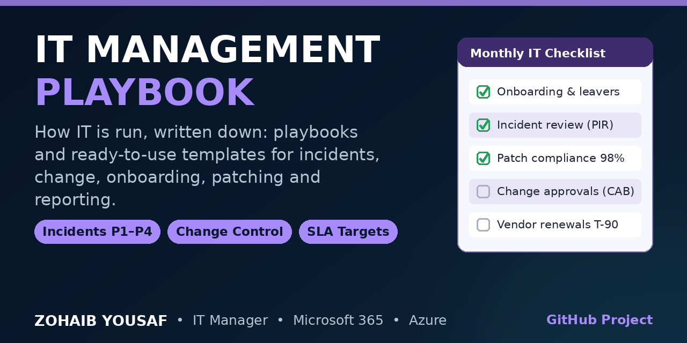

# IT Management Playbook

A practical playbook for running day-to-day IT operations in a Microsoft 365 and Intune environment: onboarding and offboarding, incident management, change control, patching, vendors and licences, and budgeting and reporting.

The documents are written to be used, not just read. Each playbook states its purpose and scope, gives step-by-step procedure, names an owner, and defines how success is measured. The templates folder contains the working forms and checklists referenced by the playbooks.

## What's inside

### Playbooks

| Document | What it covers |
|---|---|
| [User Onboarding and Offboarding](playbooks/user-onboarding-offboarding.md) | Microsoft 365 account provisioning, Intune enrolment, MFA, access reviews, and leaver data handling |
| [Incident Management](playbooks/incident-management.md) | Priority matrix (P1-P4) with response and resolution targets, escalation path, and post-incident review |
| [Change Management](playbooks/change-management.md) | Change types, CAB review, approval flow, and rollback planning |
| [Patch and Vulnerability Management](playbooks/patch-and-vulnerability-management.md) | Patch rings, Intune update rings, compliance deadlines, and reporting |
| [Vendor and License Management](playbooks/vendor-and-license-management.md) | Renewal calendar, licence true-ups, and vendor review cadence |
| [IT Budget and Reporting](playbooks/it-budget-and-reporting.md) | Annual budget categories, monthly KPI reporting, and forecast reviews |

### Templates

| Template | Used by |
|---|---|
| [Change Request Template](templates/change-request-template.md) | Change Management |
| [Incident Report Template](templates/incident-report-template.md) | Incident Management |
| [Asset Sign-off Form](templates/asset-signoff-form.md) | Onboarding and Offboarding |
| [Monthly IT Report Template](templates/monthly-it-report-template.md) | IT Budget and Reporting |
| [New Starter IT Checklist (CSV)](templates/new-starter-it-checklist.csv) | Onboarding and Offboarding |
| [SLA Targets (CSV)](templates/sla-targets.csv) | Incident Management |

## How to use

1. Copy the repository into your team's shared workspace (for example, SharePoint or your ITSM knowledge base).
2. Replace the generic placeholders such as `[Company]`, `[Service Desk]` and `[IT Manager]` with your own organisation's names.
3. Adopt one playbook at a time. Agree the KPIs in each document with your stakeholders before you start measuring against them.
4. Review each playbook quarterly, or after any major incident or organisational change, and record the review date at the top of the document.

## Author

**Zohaib Yousaf** — IT Manager / Digital Operations, Islamabad, Pakistan
6+ years in IT operations: SCCM/Intune, Microsoft 365, Azure, LAN/WAN, helpdesk and endpoint support.

- Website: [zohaibyousaf.com](https://zohaibyousaf.com)
- LinkedIn: [linkedin.com/in/zohaibyousaf](https://linkedin.com/in/zohaibyousaf)
- Email: info@zohaibyousaf.com

## License

MIT — see [LICENSE](LICENSE).
